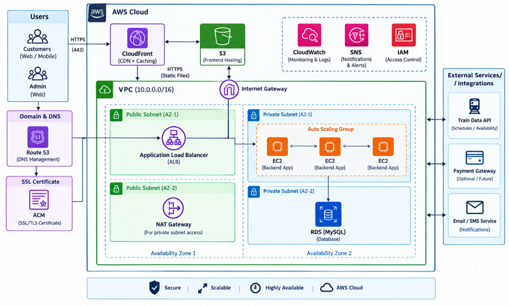
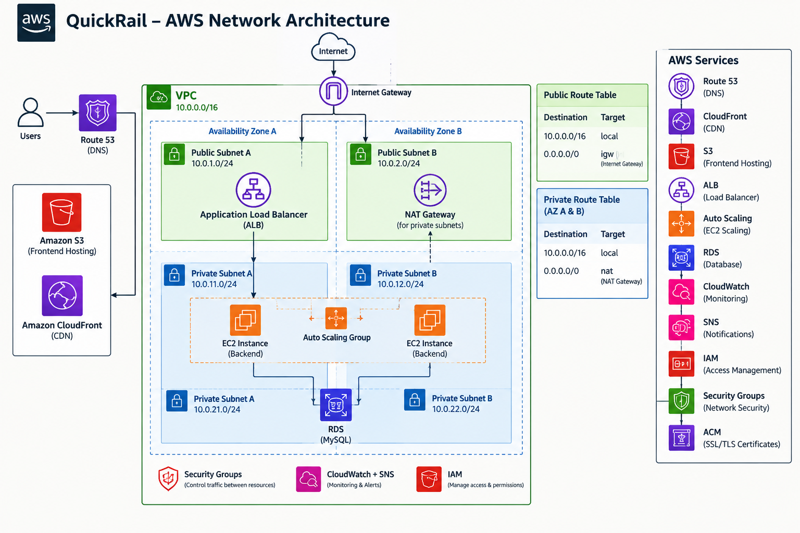
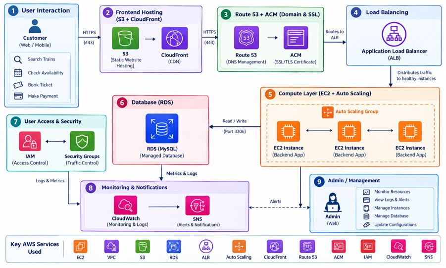

#  QuickRail – Scalable & Secure Railway Reservation System

QuickRail is a cloud-based railway reservation system developed and deployed using Amazon Web Services (AWS).

The project demonstrates how a railway reservation application can be deployed on a secure, scalable, and monitored cloud infrastructure using multiple AWS services.


## 🚀 Project Overview
QuickRail provides a railway reservation application with a cloud-based backend, database, frontend hosting, load balancing, auto scaling, domain management, HTTPS, monitoring, and notification capabilities.

The project focuses on practical implementation of AWS cloud infrastructure and demonstrates how different AWS services can work together to deploy and manage a real-world application.

## Main Objectives
- Deploy a railway reservation application on AWS
- Implement secure public and private network architecture
- Host the backend on private EC2 instances
- Use Amazon RDS MySQL for database management
- Distribute application traffic using Application Load Balancer
- Automatically manage backend EC2 capacity using Auto Scaling
- Host and deliver the frontend using S3 and CloudFront
- Configure custom domain and HTTPS using Route 53 and ACM
- Monitor infrastructure using CloudWatch
- Send monitoring notifications using SNS

---

## ☁️ AWS Architecture
QuickRail uses a layered AWS architecture consisting of public and private network resources. The frontend is hosted using Amazon S3 and delivered through CloudFront. Backend API requests are routed through Route 53 and an Application Load Balancer to private EC2 backend instances. The backend communicates with an Amazon RDS MySQL database in the private network.
The backend infrastructure is associated with an Auto Scaling Group so that EC2 capacity can be managed automatically. CloudWatch is used for monitoring and alarms, while SNS provides notifications.



---
## 🌐 Network Architecture
•	AWS VPC provides an isolated cloud networking environment.

•	Public subnets contain components requiring public connectivity, such as the Application Load Balancer and NAT Gateway.

•	Private subnets contain the backend EC2 instances and RDS database.

•	The Internet Gateway provides internet connectivity for public resources.

•	The NAT Gateway provides controlled outbound internet access for private resources.



---


## 🛠️ AWS Services Used
| AWS Service               | Purpose in QuickRail                                               |
| ------------------------- | ------------------------------------------------------------------ |
| Amazon VPC                | Provides isolated cloud networking                                 |
| Public & Private Subnets  | Organizes and isolates AWS resources                               |
| Internet Gateway          | Provides internet connectivity for public resources                |
| NAT Gateway               | Provides controlled outbound internet access for private resources |
| Amazon EC2                | Hosts the backend application                                      |
| Amazon RDS                | Hosts the MySQL database                                           |
| Application Load Balancer | Distributes incoming backend traffic                               |
| EC2 Auto Scaling          | Automatically manages backend EC2 capacity                         |
| Amazon S3                 | Hosts frontend static files                                        |
| Amazon CloudFront         | Delivers frontend content efficiently                              |
| Amazon Route 53           | Domain and DNS management                                          |
| AWS Certificate Manager   | Provides SSL/TLS certificate for HTTPS                             |
| AWS IAM                   | Manages access and permissions                                     |
| Security Groups           | Controls inbound and outbound network traffic                      |
| Amazon CloudWatch         | Monitors AWS resources and alarms                                  |
| Amazon SNS                | Sends monitoring notifications                                     |

---

## 💻 Technology Stack
Frontend
- React
- Vite
- JavaScript
- HTML
- CSS

Backend
- Node.js
- Express.js
- Prisma ORM
- REST API
- JWT Authentication
- bcryptjs
- Zod
- express-rate-limit

Database
- MySQL
- Amazon RDS

Cloud Infrastructure
- Amazon Web Services (AWS) 
- VPC
- EC2
- RDS
- Application Load Balancer
- Auto Scaling
- S3
- CloudFront
- Route 53
- ACM
- CloudWatch
- SNS
- IAM
- Security Groups

Development Tools
- Git
- GitHub
- Visual Studio Code
- AWS Management Console

---


## 🏗️ Project Architecture
QuickRail follows a layered cloud architecture.

1. Frontend Layer

The frontend application is built using React and Vite.
The production frontend is hosted in Amazon S3 and delivered through Amazon CloudFront.

2. Domain Layer

Amazon Route 53 manages the project domain and DNS records.
The frontend and backend are accessed through custom HTTPS domains.

3. Load Balancing Layer

The Application Load Balancer receives backend API requests and forwards them to healthy backend EC2 instances through the configured target group.

4. Application Layer

The backend runs on private EC2 instances.
The backend provides REST APIs for application functionality such as authentication and railway data operations.

5. Database Layer

Amazon RDS with MySQL is used as the managed relational database.
The database is placed in the private network environment and communicates with the backend securely.

6. Scalability Layer

EC2 Auto Scaling is configured to manage backend capacity according to the configured scaling policy.
The Auto Scaling Group can launch replacement EC2 instances when required.

7. Monitoring Layer

Amazon CloudWatch is used for monitoring and alarms.
Amazon SNS is used to send notification alerts generated by monitoring conditions.

---


## 🔐 Security Implementation
Security is implemented at multiple layers of the architecture.

- Backend EC2 instances are placed in private subnets.
- RDS MySQL is placed in the private network.
- Security Groups control network traffic between components.
- IAM manages AWS access and permissions.
- HTTPS is configured using AWS Certificate Manager.
- Application traffic is handled through the Application Load Balancer.
- Database credentials and environment variables are kept outside the public source code.

---


## 📈 Scalability and Availability
QuickRail uses AWS services to improve scalability and availability.

Application Load Balancer

The ALB distributes incoming API requests to healthy backend instances.

Auto Scaling

The Auto Scaling Group manages the number of backend EC2 instances based on the configured scaling policy.

This allows the infrastructure to respond to changing resource requirements and replace unhealthy or terminated instances.

CloudFront

CloudFront provides content delivery for the frontend application.

---


## 📊 Monitoring and Notifications
Amazon CloudWatch is used to monitor AWS infrastructure and configure alarms.
For QuickRail, CloudWatch is used for resource monitoring and CPU-based alarm conditions.
Amazon SNS is integrated with monitoring alerts to provide notification when configured alarm conditions occur.

---

## 🗄️ Database
QuickRail uses MySQL through Amazon RDS.

The database contains application data related to:

- Users
- Trains
- Routes
- Seat Inventory
- Bookings
- Passengers
- Payments

The backend communicates with the RDS database using Prisma ORM.

---
## 🔄 Application Workflow
The basic application request flow is:



---

## ✨ Key Features
- User authentication
- Railway train search
- Train route information
- Seat availability management
- Booking-related backend APIs
- Secure backend deployment
- Managed MySQL database
- Load-balanced backend
- Auto Scaling support
- S3 frontend hosting
- CloudFront content delivery
- Custom domain
- HTTPS
- CloudWatch monitoring
- SNS notifications

---


## 📂 Project Structure
- backend/ — backend source code, Prisma configuration, and application files
- frontend/ — frontend source code and Vite configuration
- .env.example — example environment-variable structure without actual secrets
- .gitignore — prevents secrets, dependencies, build output, and key files from being committed
- README.md — project documentation

---


## 🔑 Environment Variables
Environment-specific configuration is stored using environment variables.
For security reasons, actual .env files and credentials are not included in this repository.
Create a local .env file using .env.example and provide your own configuration.

---


## ▶️ Running the Project Locally
Backend
```bash
 cd backend
 npm install
 npm start
```

The backend runs on the configured application port.

Frontend
```bash
 cd frontend
 npm install
 npm run dev
```

The frontend can then be accessed through the local development URL provided by Vite.

---


## 🌐 Deployment
The production frontend is hosted in Amazon S3 and delivered through CloudFront. Route 53 manages the custom domain. The backend is hosted on private EC2 infrastructure behind an Application Load Balancer. The backend connects to Amazon RDS MySQL, while Auto Scaling manages backend EC2 capacity.

Frontend Deployment Flow

User → Route 53 → CloudFront → S3

Backend Deployment Flow

User/API Request → Route 53 → Application Load Balancer → Target Group → Private EC2 Backend → RDS MySQL

---

## 📸 Screenshots
Screenshots of the AWS infrastructure and QuickRail application will be added here.

AWS Infrastructure
- VPC and Subnets
- EC2 Backend
- RDS MySQL
- Application Load Balancer
- Auto Scaling Group
- S3
- CloudFront
- Route 53
- CloudWatch

Application
- QuickRail Homepage
- Train Search
- Login
- Railway Reservation Interface

---

## 🔮 Future Scope
The project can be further enhanced with:

- CI/CD automation
- Infrastructure as Code
- Advanced AWS security services
- Database optimization and scaling
- Real-time railway data integration
- AI/ML-based demand prediction
- Mobile application
- Advanced monitoring and logging
- Additional railway reservation features

---

## 👩‍💻 Author
Rupal Bothra

B.Tech – Computer Science & Engineering

Poornima Institute of Engineering & Technology, Jaipur

---

## 📄 Disclaimer
QuickRail is an academic project developed for educational and training purposes. It demonstrates cloud deployment, AWS infrastructure, networking, security, scalability, database management, content delivery, domain management, monitoring, and application deployment concepts.

---
